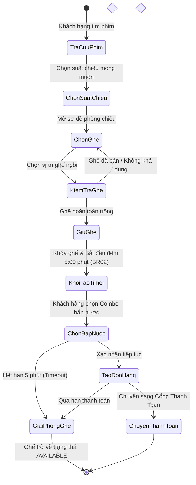
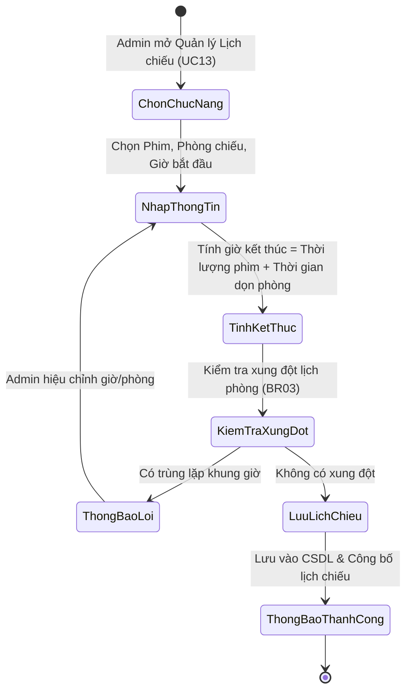

# 🎬 NOVA CINEMA (INFINITY) — HỆ THỐNG ĐẶT VÉ XEM PHIM TRỰC TUYẾN

**BÁO CÁO ĐỒ ÁN HỌC PHẦN: NHẬP MÔN KỸ NGHỆ PHẦN MỀM (LAB04)**  
**TRƯỜNG ĐẠI HỌC SƯ PHẠM THÀNH PHỐ HỒ CHÍ MINH — KHOA CÔNG NGHỆ THÔNG TIN**

---

### 👨‍🏫 GIẢNG VIÊN HƯỚNG DẪN

- **ThS. Lê Thanh Thoại**

### 👥 DANH SÁCH THÀNH VIÊN THỰC HIỆN — NHÓM 03 (LỚP: 50.01.SPTIN.B)

| STT | Họ và Tên                 | Mã số Sinh viên | Vai trò & Phạm vi phân công nhiệm vụ                                                                                                                               |
| :-: | :------------------------ | :-------------: | :----------------------------------------------------------------------------------------------------------------------------------------------------------------- |
|  1  | **Lâm Thanh Phong**       | `50.01.103.057` | **Nhóm trưởng & Phụ trách Actor C'MEMBER** (Phân tích Use Case C'MEMBER: UC02, UC05, UC06; Tổng hợp, chuẩn hóa và rà soát báo cáo; Trưởng nhóm Kỹ thuật Fullstack) |
|  2  | **Phạm Ngọc Mỹ Huyền**    | `50.01.103.028` | **Phụ trách Actor Khách hàng** (Đặc tả Use Case Khách hàng: UC01, UC03, UC04, UC07, UC08, UC09, UC10; Thiết kế quy tắc nghiệp vụ BR)                               |
|  3  | **Nguyễn Bình Phương Mi** | `50.01.103.039` | **Phụ trách Actor Nhân viên rạp** (Đặc tả Use Case Nhân viên rạp: UC02, UC14; Xây dựng mô hình quy trình nghiệp vụ BPMN)                                           |
|  4  | **Phùng Thị Mỹ Quyên**    | `50.01.103.063` | **Phụ trách Actor Admin** (Đặc tả Use Case Admin: UC11, UC12, UC13; Quản lý phim, phòng chiếu, ma trận ghế và lịch chiếu)                                          |
|  5  | **Thạch Võ Diễm Ngọc**    | `50.01.103.050` | **Phụ trách Actor Payment Sandbox** (Đặc tả ca sử dụng phối hợp thanh toán UC06; Xử lý giao dịch tài chính mô phỏng và đối soát kết quả)                           |

---

## 📌 MỤC LỤC TỔNG QUAN

1. [Giới thiệu Hệ thống NOVA Cinema](#-1-tổng-quan-hệ-thống-nova-cinema)
2. [Phân tích 5 Tác nhân (Actors)](#-2-phân-tích-các-tác-nhân-actors)
3. [Danh mục 14 Ca sử dụng (Use Cases UC01 - UC14)](#-3-danh-mục-14-use-case-hệ-thống-uc01--uc14)
4. [Quy tắc Nghiệp vụ Cốt lõi (CR-01, BR01 - BR05)](#-4-quy-tắc-nghiệp-vụ-cốt-lõi-business-rules)
5. [Mô hình hóa Quy trình Nghiệp vụ (Activity Diagram & BPMN)](#-5-mô-hình-hóa-quy-trình-nghiệp-vụ)
6. [Kiến trúc Kỹ thuật & Công nghệ (Clean Architecture)](#-6-kiến-trúc-kỹ-thuật-hệ-thống)
7. [Hướng dẫn Khởi chạy Hệ thống](#-7-hướng-dẫn-cài-đặt-và-khởi-chạy-hệ-thống)
8. [Kiểm thử & Đảm bảo Chất lượng (QA)](#-8-kiểm-thử-và-đảm-bảo-chất-lượng-qa)

---

## 📖 1. TỔNG QUAN HỆ THỐNG NOVA CINEMA

**NOVA Cinema (Infinity)** là website đặt vé xem phim trực tuyến hoàn chỉnh, cung cấp giải pháp chuyển đổi số toàn diện cho chuỗi cụm rạp chiếu phim hiện đại. Hệ thống phục vụ xuyên suốt từ khâu tra cứu lịch chiếu, lựa chọn ghế ngồi, quản lý đặt vé, thanh toán trực tuyến đến khâu kiểm soát vé bằng mã QR tại cửa phòng chiếu.

### Mục tiêu giải pháp:

- **Tối ưu hóa hành trình người dùng (User Experience)**: Giao diện _Cinematic Dark UI_ sang trọng, tra cứu phim và đặt vé nhanh chóng dưới 30 giây.
- **Giải quyết triệt để tranh chấp tài nguyên (Concurrency & Race Condition)**: Cơ chế khóa ghế bi quan và khóa phân tán giúp hàng nghìn người dùng có thể cùng lúc truy cập một suất chiếu bom tấn mà không bị trùng ghế.
- **Tự động hóa hoàn toàn vòng đời giữ chỗ (Seat Lifecycle)**: Cơ chế đếm ngược chính xác 5 phút (300 giây). Nếu quá thời gian hoặc thanh toán thất bại, hệ thống tự động giải phóng ghế ngay lập tức theo quy tắc **CR-01 / BR04**.
- **Số hóa quy trình soát vé**: Phát hành vé điện tử mã QR Vector SVG với chữ ký mật mã (admission hash 64-hex), cho phép nhân viên rạp quét và kiểm tra tính hợp lệ tức thì, ngăn chặn hoàn toàn tình trạng vé giả hoặc vé sử dụng lại.

---

## 👤 2. PHÂN TÍCH CÁC TÁC NHÂN (ACTORS)

Hệ thống NOVA Cinema xác định rõ ràng 5 Actor tương tác qua ranh giới hệ thống (_System Boundary_):

```
                        SƠ ĐỒ PHÂN CẤP TÁC NHÂN (ACTOR HIERARCHY)

            ┌────────────────┐                    ┌─────────────────┐
            │   Khách hàng   │◄───────────────────┤    C'MEMBER     │
            │   (Customer)   │  (Generalization)  │ (Thành viên rạp)│
            └───────┬────────┘                    └─────────────────┘
                    │
      ┌─────────────┼─────────────────────────────┐
      ▼             ▼                             ▼
┌───────────┐ ┌───────────┐             ┌───────────────────┐
│   Admin   │ │ Nhân viên │             │  Payment Sandbox  │
│ (Quản trị)│ │  (Staff)  │             │(Cổng thanh toán)  │
└───────────┘ └───────────┘             └───────────────────┘
```

### 1. Khách hàng (Customer)

- **Vị trí**: Nằm ngoài ranh giới hệ thống (Actor chính).
- **Mô tả**: Đại diện cho khán giả truy cập website NOVA Cinema để tìm kiếm thông tin và thực hiện đặt vé xem phim.
- **Vai trò & Chức năng**:
  - Đăng ký tài khoản người dùng cá nhân (UC01).
  - Tra cứu thông tin chi tiết 24 bộ phim và lịch chiếu các cụm rạp (UC03).
  - Chọn vị trí ghế ngồi trực quan và giữ ghế tạm thời trong 5 phút (UC04).
  - Sử dụng thuật toán gợi ý cụm ghế liền kề cho nhóm bạn bè, gia đình (UC09).
  - Tạo đơn đặt vé, tính tổng tiền vé kèm bắp nước (UC05).
  - Thực hiện thanh toán trực tuyến qua cổng Payment Sandbox (UC06).
  - Nhận vé điện tử có mã QR Code (UC07) và nhận email xác nhận giao dịch (UC08).
  - Xuất lịch xem phim dưới định dạng chuẩn `.ics` vào ứng dụng lịch điện thoại/máy tính (UC10).

### 2. C'MEMBER (Customer Member)

- **Vị trí**: Nằm ngoài ranh giới hệ thống (Actor chuyên biệt, kế thừa từ Khách hàng).
- **Mô tả**: Khách hàng thân thiết đã có tài khoản định danh trong hệ thống NOVA Cinema.
- **Quyền lợi & Chức năng bổ sung**:
  - Đăng nhập hệ thống (UC02) và duy trì phiên làm việc bảo mật.
  - Tích lũy điểm thưởng C'MEMBER theo từng hạng thẻ (Silver, Gold, Diamond).
  - Hưởng quyền lợi chiết khấu giá vé tự động và áp dụng các gói ưu đãi Party Combo (UC05).
  - Sử dụng các mã giảm giá, voucher độc quyền theo chính sách rạp.

### 3. Nhân viên rạp (Cinema Staff)

- **Vị trí**: Người dùng nội bộ vận hành tại rạp chiếu.
- **Mô tả**: Chịu trách nhiệm kiểm soát vé vào cửa trước khi khách hàng bước vào phòng chiếu.
- **Vai trò & Chức năng**:
  - Đăng nhập hệ thống bằng tài khoản nhân viên được cấp thẩm quyền (UC02).
  - Thực hiện xác thực và soát vé điện tử bằng máy quét mã QR hoặc nhập mã thủ công (UC14).
  - Đối chiếu thông tin phim, suất chiếu, phòng chiếu và số ghế hiển thị trên màn hình soát vé.
  - Ghi nhận trạng thái vé thành **ĐÃ SỬ DỤNG** (chỉ cho phép check-in 1 lần duy nhất).
  - Từ chối vé không hợp lệ, vé sai suất chiếu hoặc vé đã sử dụng trước đó.

### 4. Quản trị viên (Admin)

- **Vị trí**: Người dùng nội bộ quản lý hệ thống.
- **Mô tả**: Quản lý toàn bộ dữ liệu nền tảng, cơ sở vật chất và lịch vận hành của rạp.
- **Vai trò & Chức năng**:
  - Đăng nhập trang quản trị hệ thống (UC02).
  - Quản lý danh mục phim: thêm mới, cập nhật thông tin, thay đổi trạng thái chiếu, xóa phim (UC11).
  - Quản lý phòng chiếu và sơ đồ ghế: cấu hình hàng, cột, loại ghế (Thường, VIP, Sweetbox đôi) và kiểm tra sức chứa tối đa (UC12).
  - Quản lý lịch chiếu phim: lập kế hoạch suất chiếu, tự động kiểm tra chống xung đột phòng chiếu theo quy tắc BR03 (UC13).
  - Tra cứu, đối soát giao dịch tài chính và xuất báo cáo doanh thu định dạng CSV (UC06 / UC11).

### 5. Payment Sandbox (Cổng thanh toán giả lập)

- **Vị trí**: Hệ thống bên ngoài ranh giới NOVA Cinema (Actor phụ).
- **Mô tả**: Đại diện cho cổng thanh toán điện tử trung gian tiếp nhận và xử lý giao dịch.
- **Vai trò & Chức năng**:
  - Tiếp nhận thông số đơn hàng (mã đơn, số tiền, chữ ký giao dịch) từ NOVA Cinema gửi sang.
  - Xử lý giao dịch thanh toán mô phỏng an toàn.
  - Phản hồi trạng thái giao dịch: Thành công (Success), Thất bại (Fail), Khách hàng chủ động hủy (Canceled), hoặc Hết hạn (Timeout).

---

## 📑 3. DANH MỤC 14 USE CASE HỆ THỐNG (UC01 — UC14)

Theo đặc tả của đồ án LAB04, hệ thống gồm 14 Use Case chuẩn hóa:

|  Mã UC   | Tên Use Case                     | Actor chính                    | Actor phụ              | Mục tiêu nghiệp vụ                                                                                                             |
| :------: | :------------------------------- | :----------------------------- | :--------------------- | :----------------------------------------------------------------------------------------------------------------------------- |
| **UC01** | Đăng ký tài khoản                | Khách hàng                     | —                      | Khách hàng đăng ký tài khoản mới; hệ thống kiểm tra định dạng dữ liệu và tính duy nhất của email.                              |
| **UC02** | Đăng nhập hệ thống               | Nhân viên rạp, C'MEMBER, Admin | —                      | Xác thực tài khoản bằng mật khẩu mã hóa argon2, phân quyền theo vai trò (Customer/Staff/Admin) và cấp phiên làm việc HttpOnly. |
| **UC03** | Tra cứu phim và suất chiếu       | Khách hàng                     | —                      | Tra cứu 24 phim, lọc theo độ tuổi (P, K, T13, T16, T18), định dạng phòng (IMAX Laser, VIP) và ngày chiếu.                      |
| **UC04** | Chọn và giữ ghế                  | Khách hàng, C'MEMBER           | —                      | Chọn ghế trên sơ đồ trực quan; hệ thống kiểm tra khả dụng và tạm giữ ghế trong 300 giây theo BR02.                             |
| **UC05** | Tạo đơn đặt vé và tính tổng tiền | Khách hàng, C'MEMBER           | —                      | Tổng hợp tiền vé theo loại ghế, tích hợp Party Combo 69K, áp dụng quyền lợi C'MEMBER và voucher giảm giá.                      |
| **UC06** | Thanh toán đơn hàng              | C'MEMBER, Khách hàng           | Payment Sandbox, Admin | Chuyển tiếp thanh toán an toàn; cập nhật trạng thái đơn `PAID` và chuyển ghế sang `ĐÃ BÁN` khi thành công.                     |
| **UC07** | Nhận vé điện tử QR               | Khách hàng                     | —                      | Khách hàng nhận và xem vé điện tử chứa mã QR SVG mã hóa admission hash bảo mật cao.                                            |
| **UC08** | Nhận email xác nhận              | Khách hàng                     | —                      | Hệ thống tự động gửi email thông báo chi tiết đơn hàng, suất chiếu và đính kèm mã vé điện tử.                                  |
| **UC09** | Gợi ý cụm ghế liền nhau          | Khách hàng                     | —                      | Thuật toán quét ma trận phòng và tự động đề xuất dải ghế liền kề tối ưu cho nhóm khán giả ($\le 20$ ghế).                      |
| **UC10** | Xuất lịch xem phim `.ics`        | Khách hàng                     | —                      | Tạo tệp tin lịch điện tử `.ics` chứa thông tin phim, rạp, giờ chiếu để đồng bộ vào Google Calendar/Apple Calendar.             |
| **UC11** | Quản lý phim                     | Admin                          | —                      | Thêm, sửa, cập nhật trạng thái phim (Đang chiếu, Sắp chiếu, Ngừng chiếu); kiểm tra tính duy nhất của tên phim.                 |
| **UC12** | Quản lý phòng chiếu và sơ đồ ghế | Admin                          | —                      | Thiết lập phòng chiếu theo hàng/cột, chỉ định phân loại ghế (Thường, VIP, Đôi) và kiểm tra ngưỡng sức chứa.                    |
| **UC13** | Quản lý lịch chiếu               | Admin                          | —                      | Lập lịch chiếu phim; hệ thống tự động kiểm tra và ngăn chặn xung đột thời gian trong cùng phòng theo BR03.                     |
| **UC14** | Xác thực và soát vé QR           | Nhân viên rạp                  | Khách hàng / C'MEMBER  | Nhân viên rạp quét mã QR, đối chiếu suất chiếu, ghi nhận trạng thái **ĐÃ SỬ DỤNG** 1 lần duy nhất.                             |

### Ma trận Xử lý Soát vé QR (UC14):

| Tình huống quét vé              | Kết quả hệ thống                                                      | Hành động xử lý của Nhân viên rạp                                        |
| :------------------------------ | :-------------------------------------------------------------------- | :----------------------------------------------------------------------- |
| **Vé hợp lệ**                   | Hiển thị đúng phim, suất chiếu, phòng, số ghế; cho phép bấm Xác nhận. | Cho khách vào phòng chiếu và ghi nhận check-in lên hệ thống.             |
| **Không tìm thấy vé**           | Thông báo lỗi không tìm thấy định danh vé trong CSDL.                 | Từ chối xác nhận; yêu cầu khách hàng kiểm tra lại vé trong tài khoản.    |
| **Sai suất chiếu / ngày chiếu** | Cảnh báo vé không phù hợp với phòng chiếu hoặc giờ chiếu hiện tại.    | Không xác nhận; hướng dẫn khách hàng di chuyển đến đúng phòng/giờ chiếu. |
| **Vé đã được sử dụng**          | Cảnh báo vé đã được check-in trước đó kèm mốc thời gian đã quét.      | Từ chối tuyệt đối; chuyển xử lý theo quy định chống gian lận của rạp.    |

---

## ⚖️ 4. QUY TẮC NGHIỆP VỤ CỐT LÕI (BUSINESS RULES)

Hệ thống NOVA Cinema tuân thủ nghiêm ngặt 5 Quy tắc Nghiệp vụ (_Business Rules_) và 1 Ràng buộc Hệ thống (_Constraint_):

- **CR-01 / BR01 — Chống Đặt Trùng Ghế (Concurrency & Race Condition)**:
  - Một ghế tại một suất chiếu chỉ có thể được sở hữu bởi duy nhất một phiên giao dịch tại một thời điểm.
  - Khi có tranh chấp đồng thời, hệ thống sử dụng cơ chế khóa phân tán Redis và khóa bi quan Database để chỉ chấp thuận giao dịch đầu tiên; các giao dịch đến sau lập tức nhận cảnh báo lỗi ghế không còn khả dụng.
- **BR02 — Thời Gian Giữ Ghế Tạm Thời (Holding Deadline)**:
  - Khi khách hàng xác nhận chọn ghế, hệ thống kích hoạt bộ đếm ngược chính xác **`300 giây (05:00 phút)`**.
  - Trạng thái ghế chuyển sang `HOLDING` và được bảo lưu trong suốt thời gian khách hàng thực hiện các bước thanh toán.
- **BR03 — Chống Xung Đột Suất Chiếu (Showtime Non-overlapping)**:
  - Không được phép tạo hai suất chiếu có khung giờ trùng lặp trong cùng một phòng chiếu.
  - Giờ bắt đầu của suất chiếu sau phải cách giờ kết thúc của suất chiếu trước một khoảng thời gian tối thiểu (15 — 20 phút) phục vụ công tác dọn phòng và chuẩn bị kỹ thuật.
- **BR04 — Giải Phóng Ghế Tự Động (Auto Seat Release)**:
  - Trong mọi trường hợp đơn hàng không thành công (hết hạn 5 phút giữ ghế, khách hàng chủ động hủy đơn, hoặc cổng thanh toán Sandbox báo thất bại), hệ thống tự động hủy đơn và hoàn trả toàn bộ số ghế về trạng thái `AVAILABLE` cho cộng đồng.
- **BR05 — Giới Hạn Đơn Hàng & Chính Sách Hội Viên**:
  - Mỗi đơn hàng được đặt tối đa **20 ghế** (bao gồm cả hai chỗ ngồi của ghế đôi Sweetbox).
  - Điểm thưởng C'MEMBER và mã giảm giá chỉ được khấu trừ trên phần tiền vé hợp lệ, đảm bảo tổng tiền đơn hàng không âm.

---

## 🔄 5. MÔ HÌNH HÓA QUY TRÌNH NGHIỆP VỤ

### 1. Activity Diagram — Đặt vé và Giữ ghế (Hình 3.1)



### 2. Activity Diagram — Quản lý Lịch chiếu Admin (Hình 3.2)



### 3. BPMN — Quy trình Đặt vé, Thanh toán & Phát hành Vé (Hình 4.1)

Hệ thống phối hợp nhịp nhàng giữa 3 Lane chuyên biệt:

```
  [ LANE 1: KHÁCH HÀNG ]
     (Start) ──► [Chọn Phim & Suất] ──► [Chọn Ghế] ──► [Xác Nhận Đơn] ──► [Thực Hiện Thanh Toán] ──────────┐
                                             ▲                                                             │
  ───────────────────────────────────────────┼─────────────────────────────────────────────────────────────┼─────
  [ LANE 2: NOVA CINEMA ]                    │                                                             │
     [Nhận Yêu Cầu Ghế] ──► <Ghế Trống?> ────┘(Báo lỗi)                                                    │
                                │ (Có)                                                                     │
                                ▼                                                                          │
                         [Khóa Ghế 5 Phút] ──► [Tạo Đơn Hàng] ──► [Gửi Yêu Cầu Thanh Toán]                 │
                                                                           │                               │
  ─────────────────────────────────────────────────────────────────────────┼───────────────────────────────┼─────
  [ LANE 3: PAYMENT SANDBOX ]                                              │                               ▼
                                                                           └───────────────► [Xử Lý Giao Dịch Mô Phỏng]
                                                                                                   │
  ─────────────────────────────────────────────────────────────────────────────────────────────────┼─────
  [ KẾT QUẢ PHẢN HỒI ]                                                                            ▼
  • NẾU THÀNH CÔNG: NOVA Cinema cập nhật CSDL ──► Đổi trạng thái Ghế: ĐÃ BÁN (SOLD) ──► [Phát Hành Vé Điện Tử QR]
  • NẾU THẤT BẠI / TIMEOUT: NOVA Cinema kích hoạt BR04 ──► Hủy Đơn Hàng ──► [Tự Động Giải Phóng Ghế Về Trạng Thái Trống]
```

---

## 🏛 6. KIẾN TRÚC KỸ THUẬT HỆ THỐNG

Dự án được xây dựng theo tiêu chuẩn **Clean Architecture** và **BFF (Backend For Frontend)** hiện đại:

- **Frontend (Client Experience)**:
  - **Next.js 16 (App Router)** và **React 19**: Tối ưu hóa SEO, kết xuất phía máy chủ (SSR) kết hợp Client-Side Rendering linh hoạt.
  - **Tailwind CSS v3**: Hệ thống giao diện Cinematic Glassmorphism, chuyển đổi linh hoạt trên mọi kích thước màn hình (Desktop, Tablet, Mobile 320px).
  - **Three.js & GSAP 3.15**: Mô phỏng màn chiếu cong 3D IMAX tại `/xem-truoc`.
  - **Biểu tượng Thương hiệu NV — VN**: Monogram thiết kế tinh tế với 2 chiều ý nghĩa: nhìn xuôi là **VN (Việt Nam)** đại diện cho _Khát vọng vươn mình của dân tộc_, nhìn thương hiệu là **NV (NOVA Cinema)**, sử dụng cặp màu Bạch Kim & Hoàng Kim đẳng cấp.
- **Backend API (Core Engine)**:
  - **NestJS 11** cấu trúc module độc lập: `AuthModule`, `MoviesModule`, `CinemasModule`, `ShowtimesModule`, `BookingsModule`, `PaymentsModule`, `TicketsModule`.
  - **Bảo mật**: Mã hóa mật khẩu chuẩn công nghiệp `argon2`, JWT Access Token & Refresh Token lưu trong cookie HttpOnly SameSite=Lax chống tấn công XSS/CSRF.
  - **SSE (Server-Sent Events) Gateway**: Luồng `/api/seat-events/:id` truyền dữ liệu ghế trực tiếp về trình duyệt, phản ứng tức thời với độ trễ dưới 50ms.
- **Cơ sở Dữ liệu & Lưu trữ**:
  - **PostgreSQL 17**: Quản lý toàn vẹn quan hệ giữa 24 phim, 4 cụm rạp, 128 phòng chiếu, hơn 13.440 suất chiếu và lịch sử giao dịch.
  - **Prisma ORM 6.19**: Quản lý schema, sinh migration tự động và đảm bảo Type-safe trong mã nguồn.

---

## 🚀 7. HƯỚNG DẪN CÀI ĐẶT VÀ KHỞI CHẠY HỆ THỐNG

Dùng Node24 theo `.nvmrc`. Từ thư mục gốc repository:

```bash
npm install
npm run seed
npm run dev
```

Web: **http://localhost:3000** · API: **http://127.0.0.1:4000/api/v1**.

- Mã giao diện chạy tại **`frontend/src/`**, ảnh tại `frontend/public/`; backend tại `backend/`; tài liệu tại `docs/`. Các lệnh gốc đã trỏ vào đúng workspace mới. Source gốc được giữ tương thích, không dùng làm bản chạy thứ hai.
- Fresh clone chưa cấu hình PostgreSQL dùng backend RAM native theo lựa chọn của nhóm: có luồng giữ ghế/thanh toán Sandbox/QR thật trong process, dữ liệu reset khi khởi động lại. Không cần Docker. Nếu dùng `.env` cũ, có thể đặt `NOVA_BACKEND_MODE=memory` để chủ động chọn chế độ này.
- Cấu hình frontend mới tại `frontend/.env.local` theo `frontend/.env.example`; cấu hình upstream/origin cũ ở root vẫn được đọc làm fallback, ưu tiên biến frontend/shell.
- Muốn lưu bền vững: cài PostgreSQL/Redis native, cấu hình `backend/.env` với database UTF8/Unicode, URL/Redis và SEED_DEMO_PASSWORD riêng; chạy `npm run setup:local`. Không có bước tự khởi chạy container.
- Seed additive giữ dữ liệu đã chỉnh; có4 tài khoản customer/cmember/staff/admin tại `@nova.vn`, hội viên mới có50.000 điểm; giữ các tài khoản `.local` đã có. C’MEMBER hiện có chiết khấu theo hạng và tích điểm; API đổi điểm thành tiền chưa triển khai.

Các trang chính: `/phim`, `/sap-chieu`, `/dat-ve`, `/rap`, `/bap-nuoc`, `/hoi-vien`, `/tai-khoan`, `/soat-ve`, `/quan-tri`. Những đường dẫn mới `/movies`, `/booking`, `/checkout`, `/tickets`, `/staff`, `/admin` chuyển đến luồng tương ứng và giữ query của đơn hàng.

Chi tiết Windows, cấu hình native, RTM20 ca kiểm thử và giới hạn nghiệp vụ: [báo cáo backend native](docs/qa/backend-native-audit.md).

---

## 🧪 8. KIỂM THỬ VÀ ĐẢM BẢO CHẤT LƯỢNG (QA)

Kiểm toán SIT/E2E/Concurrency/Security mới: [69 kịch bản truy vết](docs/qa/ultra-expanded-audit.md). Với PostgreSQL/Redis native và database test riêng đã cấu hình, chạy một lệnh:

Bản tối ưu sau kiểm toán: [catalogue chia trang đầy đủ, cache an toàn và phát hành QR nhanh](docs/qa/performance-optimization.md), có số đo riêng cho cache lạnh/nóng, từng response và tổng catalogue.

Rà soát frontend tiếp theo: [ổn định đặt vé, giảm tải ảnh/JS và dọn hiệu ứng 3D](docs/qa/frontend-stability-review.md), giữ nguyên backend/API và có kiểm thử hồi quy riêng.

```powershell
npm run qa:native
```

Runner không gọi Docker, chạy các bộ ghi database tuần tự và lưu log/summary trong `.runtime/qa-native/<run-id>/`. Kết quả chức năng và các mục tiêu độ trễ/kích thước được tách trong báo cáo; không báo đạt 30/50 ms nếu số đo vượt ngưỡng. `npm run qa:native -- --api-only` dành cho backend/schema/Node/lint. Cần cài Chromium cho Playwright nếu máy chưa có.

```bash
npm run test:unit
npm run test:backend
npm run test:business
npm run test:db
npm run lint
npm run build
npm test
```

HTTP/DB/browser tests cần PostgreSQL/Redis test riêng và migration; không chạy ghi dữ liệu vào database người dùng. Production browser: build trước, đặt `NOVA_QA_PRODUCTION=1` rồi `npm test` (PowerShell: `$env:NOVA_QA_PRODUCTION="1"`).

Kiểm toán bổ sung và hướng dẫn TC-01…TC-05/ma trận UC14: [Fullstack LAB04](docs/qa/fullstack-lab04-audit.md). PostgreSQL hiện hữu cần `npm run setup:local` sau pull để apply migration trạng thái tài khoản và build dist mới.

Báo cáo kiểm chứng mới gồm [STLC/RTM backend native](docs/qa/backend-native-audit.md), [frontend/network audit](docs/qa/frontend-performance-audit.md), số đo trong `docs/qa/measurements/` và ảnh trong `docs/qa/screenshots/`. Kết quả lịch sử trong các báo cáo khác giữ nguyên thời điểm của từng lượt; không gộp thành cam kết100% cho mọi tình huống.

---

## 🎯 9. KẾT LUẬN

Báo cáo Đồ án **LAB04 — NOVA CINEMA (INFINITY)** đã hoàn thành xuất sắc các mục tiêu nghiên cứu và thực nghiệm:

1. Hoàn thiện bộ tài liệu phân tích Use Case, ma trận xử lý, mô hình hóa quy trình nghiệp vụ với Activity Diagram và BPMN 3 Lane chuyên nghiệp.
2. Xây dựng thành công sản phẩm phần mềm thực tế với hiệu năng cao, giao diện tối tân, giải quyết triệt để bài toán giữ ghế thời gian thực và quản lý vé thông minh.
3. Đáp ứng đầy đủ các tiêu chuẩn học thuật của Khoa Công nghệ Thông tin — Trường Đại học Sư phạm TP. Hồ Chí Minh.

---

_Bản quyền Đồ án thuộc về **Tập thể Nhóm 03 — Lớp 50.01.SPTIN.B — Khoa CNTT, HCMUE**._
