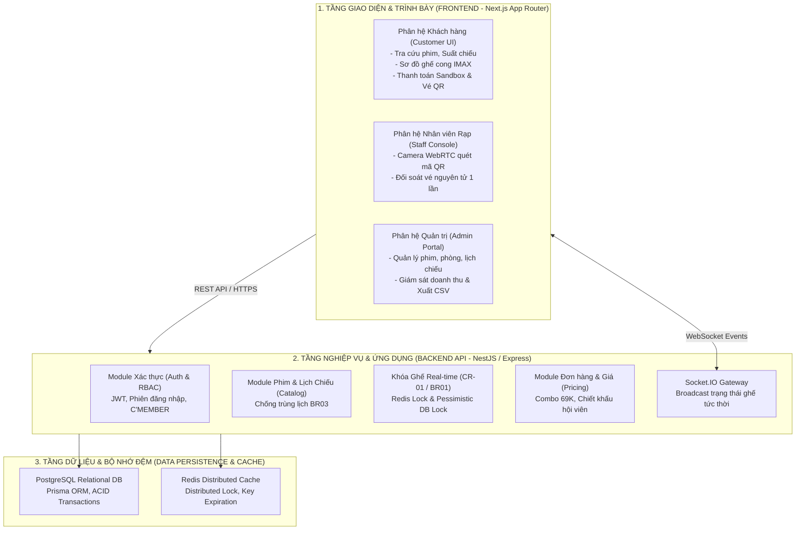

# 🏗️ TÀI LIỆU KIẾN TRÚC HỆ THỐNG & ĐẶC TẢ USE CASE (ARCHITECTURE SPECIFICATION)

## DỰ ÁN: WEBSITE ĐẶT VÉ XEM PHIM TRỰC TUYẾN NOVA CINEMA (INFINITY)

**Trường Đại học Sư phạm TP. Hồ Chí Minh (HCMUE) — Khoa Công nghệ Thông tin**  
**Nhóm 03 — Lớp: 50.01.SPTIN.B | GVHD: ThS. Lê Thanh Thoại**

---

## 🏛️ 1. MÔ HÌNH KIẾN TRÚC TỔNG THỂ (CLEAN ARCHITECTURE 3 TẦNG)

Hệ thống **NOVA CINEMA (INFINITY)** được thiết kế theo mô hình Monorepo phân tách rõ ràng trách nhiệm giữa Frontend, Backend API và Tầng Dữ liệu:



---

## 📁 2. CẤU TRÚC THƯ MỤC ĐANG CHẠY (28/10/2026)

```text
nova-cinema/
├── frontend/                    Next.js workspace đang chạy
│   ├── src/app/                 Trang tiếng Việt, route aliases, BFF và SSE
│   ├── src/components/          BookingConsole, SoatVeNhanVien, QuanTriHeThong...
│   ├── src/api/                 API client, timeout, session, error messages
│   ├── src/three/               Màn chiếu Three.js/GSAP + cleanup
│   ├── public/                  Ảnh/poster/font/tài nguyên tĩnh
│   ├── .env.example             Mẫu frontend/.env.local (BFF upstream)
│   └── next.config.mjs          Redirects, env compatibility, Node server packages
├── backend/                     NestJS workspace + RAM development adapter
│   ├── src/modules/             auth/users, catalog, bookings, payments, tickets,
│   │                            notifications, reports, audit
│   ├── src/realtime/            Socket.IO
│   ├── src/queues/              BullMQ/outbox/expiry/email
│   ├── src/database/            Prisma lifecycle, pool/timeout, UnitOfWork
│   ├── prisma/                  schema.prisma, migrations, additive seed
│   ├── standalone/              API RAM tạm thời khi startup fallback
│   ├── test/                    HTTP, PostgreSQL, Socket.IO, SMTP test fixtures
│   └── .env.example             DB/Redis/JWT/Sandbox/SMTP server configuration
├── content/                     Dữ liệu catalogue/seed và cấu hình ảnh dùng chung
├── scripts/                     Launcher, setup/seed, smoke, Node tests
├── tests/                       Playwright toàn luồng frontend → BFF → Nest → DB
├── docs/                        LAB03/LAB04, hướng dẫn, QA evidence
└── package.json                 npm workspaces + lệnh chạy/build/test từ root
```

`src/` và `public/` cũ ở root được giữ tương thích, không được root scripts dùng làm frontend thứ hai. Alias `@/` nằm trong frontend/jsconfig.json và trỏ tới frontend/src. Các thư mục English route `(customer)/movies`, `booking`, `checkout`, `tickets` có thật nhưng chuyển đến luồng canonical `/phim`, `/dat-ve`, `/tai-khoan`; quyền Admin/Staff vẫn được backend kiểm tra. Không di chuyển file chỉ để khớp một sơ đồ mục tiêu cũ.

[Xem đường dẫn implementation và cách chạy trong VS Code](00_DOC_DAU_TIEN_HUONG_DAN_XEM_CODE_VSCODE.md) · [Kiểm toán14 UC và TC-01…TC-05](qa/fullstack-lab04-audit.md).

---

## 👥 3. PHÂN TÍCH 5 TÁC NHÂN (ACTORS) VÀ 14 USE CASES (UC01 - UC14)

### 3.1. Danh Sách 5 Tác Nhân:

1. **Khách hàng (Customer)**: Người dùng vãng lai truy cập website để tra cứu phim, chọn suất chiếu, chọn ghế, mua bắp nước và đặt vé trực tuyến.
2. **Hội viên C'MEMBER**: Khách hàng đã đăng ký tài khoản thành viên, được hưởng chính sách tích lũy điểm thưởng và chiết khấu giá vé theo bậc (Silver / Gold / Diamond).
3. **Nhân viên rạp (Staff)**: Sử dụng thiết bị có camera để quét mã QR vé xem phim, kiểm tra tính hợp lệ và cho phép khách hàng vào rạp.
4. **Quản trị viên (Admin)**: Quản lý toàn diện dữ liệu hệ thống (phim, phòng chiếu, ma trận ghế, lịch chiếu) và giám sát doanh thu.
5. **Cổng thanh toán Sandbox (Payment Sandbox)**: Hệ thống ngân hàng giả lập, chịu trách nhiệm xử lý giao dịch tài chính mô phỏng và gửi tín hiệu xác nhận thanh toán.

### 3.2. Bảng Ma Trận 14 Use Cases:

|  Mã UC   | Tên Ca Sử Dụng                            | Tác Nhân Thực Hiện                 | Phân Công Nhóm                          |
| :------: | :---------------------------------------- | :--------------------------------- | :-------------------------------------- |
| **UC01** | Đăng ký tài khoản                         | Khách hàng                         | Phạm Ngọc Mỹ Huyền                      |
| **UC02** | Đăng nhập hệ thống                        | Khách hàng, C'MEMBER, Staff, Admin | Lâm Thanh Phong & Nguyễn Bình Phương Mi |
| **UC03** | Tra cứu phim và lịch chiếu                | Khách hàng                         | Phạm Ngọc Mỹ Huyền                      |
| **UC04** | Chọn ghế & giữ chỗ tạm thời (5 phút)      | Khách hàng, C'MEMBER               | Phạm Ngọc Mỹ Huyền                      |
| **UC05** | Tạo đơn hàng & áp dụng quyền lợi hội viên | C'MEMBER                           | Lâm Thanh Phong                         |
| **UC06** | Thanh toán đơn hàng qua Sandbox           | C'MEMBER, Payment Sandbox          | Lâm Thanh Phong & Thạch Võ Diễm Ngọc    |
| **UC07** | Nhận và xem vé điện tử mã QR              | Khách hàng, C'MEMBER               | Phạm Ngọc Mỹ Huyền                      |
| **UC08** | Nhận email xác nhận đặt vé                | Khách hàng                         | Phạm Ngọc Mỹ Huyền                      |
| **UC09** | Tự động gợi ý dải ghế liền kề             | Khách hàng, C'MEMBER               | Phạm Ngọc Mỹ Huyền                      |
| **UC10** | Xuất lịch chiếu cá nhân (.ics)            | Khách hàng                         | Phạm Ngọc Mỹ Huyền                      |
| **UC11** | Quản lý danh mục phim                     | Quản trị viên (Admin)              | Phùng Thị Mỹ Quyên                      |
| **UC12** | Quản lý phòng chiếu & sơ đồ ghế           | Quản trị viên (Admin)              | Phùng Thị Mỹ Quyên                      |
| **UC13** | Quản lý lịch chiếu phim (BR03)            | Quản trị viên (Admin)              | Phùng Thị Mỹ Quyên                      |
| **UC14** | Xác thực & Soát vé mã QR                  | Nhân viên rạp (Staff)              | Nguyễn Bình Phương Mi                   |

---

## ⚡ 4. CẤU HÌNH IMPORT ALIAS ĐỂ ĐẢM BẢO ĐƯỜNG DẪN KHÔNG BỊ GÃY

Để hỗ trợ đầy đủ các đường dẫn import tuyệt đối (`@/components/...`, `@/services/...`, `@modules/...`), dự án thiết lập cấu hình chuẩn tại:

### Frontend (`jsconfig.json`):

```json
{
  "compilerOptions": {
    "baseUrl": ".",
    "paths": {
      "@/*": ["./src/*"],
      "@/components/*": ["./src/components/*"],
      "@/services/*": ["./src/services/*", "./src/api/*"],
      "@/app/*": ["./src/app/*"]
    }
  },
  "include": ["src/**/*", "tests/**/*"]
}
```

### Backend (`backend/tsconfig.json`):

```json
{
  "compilerOptions": {
    "baseUrl": "./",
    "paths": {
      "@modules/*": ["src/modules/*"],
      "@common/*": ["src/common/*"],
      "@config/*": ["src/config/*"],
      "@database/*": ["src/database/*"],
      "@realtime/*": ["src/realtime/*"]
    }
  }
}
```
