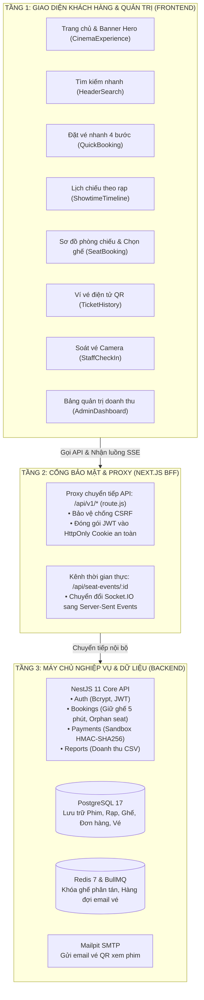
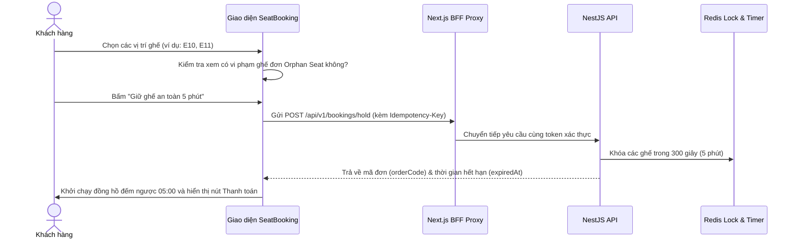
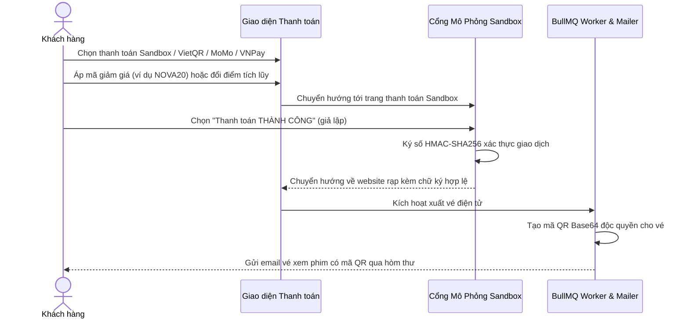

# BẢN ĐỒ CHỨC NĂNG, TIẾN TRÌNH VÀ HƯỚNG DẪN MÃ NGUỒN TOÀN DIỆN
## DỰ ÁN HỆ THỐNG RẠP CHIẾU PHIM ĐIỆN ẢNH NOVA CINEMA — INFINITY EXPERIENCE

> 📖 **Dành cho ai?** Tài liệu này được biên soạn đặc biệt dành cho các thành viên trong nhóm, sinh viên ngành Công nghệ phần mềm, giảng viên chấm bài, hoặc **bất kỳ ai không rành về lập trình** đều có thể đọc, hiểu và nắm rõ toàn bộ nhiệm vụ của từng file, quy trình hoạt động của từng trang, cũng như các suy nghĩ/ý tưởng mở rộng tính năng cho hệ thống.

---

## MỤC LỤC
1. [Tổng Quan Kiến Trúc Hệ Thống 3 Tầng](#1-tổng-quan-kiến-trúc-hệ-thống-3-tầng)
2. [Bản Đồ Tra Cứu Từng Trang & Chức Năng Giao Diện](#2-bản-đồ-tra-cứu-từng-trang--chức-năng-giao-diện)
3. [Chi Tiết Tiến Trình Nghiệp Vụ Từng Bước (Step-by-Step Workflows)](#3-chi-tiết-tiến-trình-nghiệp-vụ-từng-bước-step-by-step-workflows)
   - [Tiến trình 1: Luồng Đặt vé & Giữ ghế 5 phút](#tiến-trình-1-luồng-đặt-vé--giữ-ghế-5-phút)
   - [Tiến trình 2: Luồng Đồng bộ trạng thái ghế thời gian thực (Realtime SSE)](#tiến-trình-2-luồng-đồng-bộ-trạng-thái-ghế-thời-gian-thực-realtime-sse)
   - [Tiến trình 3: Luồng Kiểm tra luật Orphan Seat (Chống bỏ trống ghế đơn)](#tiến-trình-3-luồng-kiểm-tra-luật-orphan-seat-chống-bỏ-trống-ghế-đơn)
   - [Tiến trình 4: Luồng Xác nhận độ tuổi khán giả (T13, T16, T18)](#tiến-trình-4-luồng-xác-nhận-độ-tuổi-khán-giả-t13-t16-t18)
   - [Tiến trình 5: Luồng Thanh toán Sandbox & Nhận vé điện tử QR](#tiến-trình-5-luồng-thanh-toán-sandbox--nhận-vé-điện-tử-qr)
   - [Tiến trình 6: Luồng Soát vé vào cửa của Nhân viên rạp](#tiến-trình-6-luồng-soát-vé-vào-cửa-của-nhân-viên-rạp)
   - [Tiến trình 7: Luồng Quản trị rạp & Báo cáo doanh thu của Admin](#tiến-trình-7-luồng-quản-trị-rạp--báo-cáo-doanh-thu-của-admin)
4. [Bảng Tra Cứu Toàn Bộ Tệp Tin Mã Nguồn (File Directory Map)](#4-bảng-tra-cứu-toàn-bộ-tệp-tin-mã-nguồn-file-directory-map)
5. [Kho Ý Tưởng & Gợi Ý Mở Rộng Phát Triển Thêm (Future Roadmap)](#5-kho-ý-tưởng--gợi-ý-mở-rộng-phát-triển-thêm-future-roadmap)

---

## 1. TỔNG QUAN KIẾN TRÚC HỆ THỐNG 3 TẦNG

Hệ thống được thiết kế theo tiêu chuẩn công nghiệp hiện đại, phân tách độc lập và bảo mật cao:

---

## 2. BẢN ĐỒ TRA CỨU TỪNG TRANG & CHỨC NĂNG GIAO DIỆN

| STT | Trang / Màn Hình | Tệp Tin Mã Nguồn Chính | Chức Năng & Trách Nhiệm Phục Vụ |
| :---: | :--- | :--- | :--- |
| **1** | **Trang chủ & Bố cục gốc** | `src/app/page.jsx` `src/app/layout.jsx` `src/App.jsx` | Hiển thị toàn bộ giao diện rạp, banner bom tấn, các thanh điều hướng và khởi chạy ứng dụng. |
| **2** | **Thanh tìm kiếm phim & rạp** | `src/components/HeaderSearch.jsx` | Tìm kiếm trực tiếp theo tên phim (cả có dấu và không dấu), tên rạp hoặc đạo diễn. |
| **3** | **Đặt vé nhanh 4 bước** | `src/components/QuickBooking.jsx` | 4 bước tiện lợi: Chọn rạp → Chọn phim → Chọn ngày → Chọn suất chiếu (hiển thị số ghế trống theo thời gian thực). |
| **4** | **Lịch chiếu & Suất chiếu** | `src/components/ShowtimeTimeline.jsx` | Xem lịch chiếu theo từng rạp, từng ngày, phân biệt giá vé ngày thường và cuối tuần. |
| **5** | **Sơ đồ phòng chiếu & Đặt ghế** | `src/components/SeatBooking.jsx` `src/bookingStore.js` | Hiển thị 160 ghế trực quan, chọn ghế đôi/VIP, đồng hồ giữ ghế 5 phút, cảnh báo ghế đơn orphan. |
| **6** | **Combo bắp nước ẩm thực** | `src/components/FoodArt.jsx` | Minh họa bắp rang bơ và ly nước mát lạnh dựng 100% bằng CSS, ưu đãi Combo chỉ từ 69.000đ. |
| **7** | **Thanh toán Sandbox** | `src/components/SeatBooking.jsx` `backend/.../payments` | Hỗ trợ quét mã VietQR, ví MoMo, VNPay, nhập mã giảm giá Coupon và đổi điểm tích lũy C'MEMBER. |
| **8** | **Ví vé điện tử của khách** | `src/components/TicketHistory.jsx` | Quản lý vé đã mua, xem mã QR vào rạp, tải ảnh QR PNG, xuất file lịch `.ics`, tiếp tục đơn đang giữ. |
| **9** | **Trạm soát vé của nhân viên** | `src/components/StaffCheckIn.jsx` | Quét mã QR bằng Camera WebRTC hoặc nhập mã tay; hệ thống kiểm tra giờ chiếu và chống soát vé 2 lần. |
| **10** | **Bảng quản trị Admin** | `src/components/AdminDashboard.jsx` `src/components/OperationalCatalog.jsx` | Xem báo cáo tài chính doanh thu, số vé bán, xuất CSV, quản lý phim, rạp, phòng chiếu và người dùng. |
| **11** | **Đăng ký & Đăng nhập** | `src/components/AuthForm.jsx` `src/api/client.js` | Đăng ký thành viên mới, đăng nhập bảo mật, có nút gợi ý tài khoản mẫu cho giảng viên nghiệm thu. |
| **12** | **Đa ngôn ngữ Song ngữ** | `src/components/LanguageProvider.jsx` `src/i18n.js` | Chuyển đổi mượt mà giữa Tiếng Việt và Tiếng Anh chỉ với một nút bấm trên Navbar. |

---

## 3. CHI TIẾT TIẾN TRÌNH NGHIỆP VỤ TỪNG BƯỚC (STEP-BY-STEP WORKFLOWS)

### Tiến trình 1: Luồng Đặt vé & Giữ ghế 5 phút

### Tiến trình 2: Luồng Đồng bộ trạng thái ghế thời gian thực (Realtime SSE)
- **Vấn đề thực tế**: Khi có hàng trăm người cùng truy cập một suất chiếu phim bom tấn, làm sao để khi Khách A vừa bấm chọn ghế E10 thì Khách B ở máy khác lập tức thấy ghế E10 chuyển sang màu xám (đã bị giữ) mà không cần bấm F5?
- **Cách hệ thống xử lý**:
  1. Khi mở giao diện sơ đồ ghế, trình duyệt tạo kết nối `new EventSource('/api/seat-events/' + showtimeId)`.
  2. Next.js kết nối vào Socket.IO room của suất chiếu đó ở Backend.
  3. Bất cứ khi nào có hành động giữ ghế, hủy ghế hoặc thanh toán thành công, Backend bắn sự kiện sang Redis Pub/Sub.
  4. Trình duyệt của Khách B nhận được tín hiệu và tự động cập nhật lại màu sắc ghế trong vòng chưa đầy 0.1 giây.

### Tiến trình 3: Luồng Kiểm tra luật Orphan Seat (Chống bỏ trống ghế đơn)
- **Quy tắc rạp chiếu phim**: Không cho phép khách hàng đặt vé để lại một ghế trống duy nhất cô độc ở đầu hàng hoặc kẹp giữa các ghế đã bán (vì ghế đơn lẻ loi rất khó bán cho người đến sau).
- **Cách thuật toán hoạt động (`checkClientOrphanSeats` & `orphan-seats.ts`)**:
  1. Quét từng hàng ghế từ cột 1 đến cột cuối cùng.
  2. Tính toán độ dài các chuỗi ghế trống liên tiếp ban đầu.
  3. Mô phỏng tình trạng dãy ghế sau khi khách nhấc những ghế đang chọn ra.
  4. Nếu phát hiện xuất hiện một khoảng trống chỉ có đúng 1 ghế (trong khi trước đó là dải ghế dài ≥ 2 chỗ) -> Lập tức chặn lại và thông báo: *"Không được để lại ghế trống đơn lẻ tại vị trí E9. Vui lòng chọn ghế liền kề!"*.

### Tiến trình 4: Luồng Xác nhận độ tuổi khán giả (T13, T16, T18)
- **Quy định pháp lý**: Tuân thủ nghiêm ngặt **Thông tư 05/2023/TT-BVHTTDL** của Bộ Văn hóa, Thể thao và Du lịch:
  - **P**: Phim phổ biến cho mọi độ tuổi.
  - **K**: Phim cho khán giả dưới 13 tuổi với điều kiện có cha mẹ/người giám hộ đi cùng.
  - **T13**: Dành cho khán giả từ đủ 13 tuổi trở lên.
  - **T16**: Dành cho khán giả từ đủ 16 tuổi trở lên.
  - **T18**: Dành cho khán giả từ đủ 18 tuổi trở lên.
- **Cách xử lý trên hệ thống**:
  Khi khán giả bấm thanh toán cho phim T16 hoặc T18, một hộp thoại pháp lý màu cam/đỏ (`AgeRatingModal`) xuất hiện, giải thích rõ quy định, yêu cầu khán giả đánh dấu cam kết mang theo CCCD/VNeID mức 2 khi đến rạp, và nêu rõ vé sẽ không được hoàn tiền nếu bị nhân viên từ chối do chưa đủ tuổi.

### Tiến trình 5: Luồng Thanh toán Sandbox & Nhận vé điện tử QR

### Tiến trình 6: Luồng Soát vé vào cửa của Nhân viên rạp
1. Khách hàng xuất trình vé điện tử trên điện thoại hoặc bản in có mã QR.
2. Nhân viên rạp mở màn hình **Soát vé** (`StaffCheckIn`).
3. Hướng camera vào mã QR của khách; trình duyệt dùng `BarcodeDetector` đọc chuỗi mã hash.
4. Gửi yêu cầu kiểm tra lên `/staff/check-in`:
   - Kiểm tra xem suất chiếu có đúng ngày giờ hiện tại không (chỉ hợp lệ từ 30 phút trước giờ chiếu đến 15 phút sau khi phim chiếu).
   - Kiểm tra vé đã từng được soát trước đó chưa (`isCheckedIn === true`).
5. Nếu hợp lệ: Màn hình hiện màu xanh thành công, hiển thị tên phim, phòng chiếu và số ghế. Nếu đã soát rồi: Báo động màu đỏ cảnh báo vé đã sử dụng!

### Tiến trình 7: Luồng Quản trị rạp & Báo cáo doanh thu của Admin
1. Quản trị viên đăng nhập bằng tài khoản có quyền `ADMIN`.
2. Mở **Admin Dashboard**:
   - **Tab Doanh thu**: Xem tổng số tiền thu được, phân tách doanh thu vé xem phim và doanh thu bắp nước combo, lọc theo khoảng ngày (Hôm nay, 7 ngày qua, 30 ngày qua). Bấm **Xuất CSV** để tải báo cáo tài chính về máy tính.
   - **Tab Vận hành rạp**: Thêm phim mới, tạo phòng chiếu (hệ thống tự động sinh 160 ghế chuẩn cho phòng mới), lên lịch chiếu phim và tạo combo khuyến mại.
   - **Tab Người dùng**: Quản lý danh sách thành viên, cấp vai trò STAFF hoặc xem điểm thưởng C'MEMBER.
   - **Tab Hệ thống**: Kiểm tra trạng thái máy chủ, dọn dẹp hàng đợi Outbox cũ.

---

## 4. BẢNG TRA CỨU TOÀN BỘ TỆP TIN MÃ NGUỒN (FILE DIRECTORY MAP)

Dưới đây là bảng giải thích chi tiết từng tệp tin trong toàn bộ dự án để bạn đọc lướt qua là hiểu ngay nhiệm vụ của từng file:

### Phân hệ Frontend (Next.js & React UI)
| Đường Dẫn File | Tên Tiếng Việt Chuẩn Hóa | Nhiệm Vụ Cụ Thể |
| :--- | :--- | :--- |
| `src/app/page.jsx` | Trang chủ Root Server | Điểm khởi đầu của website phía server; nạp giao diện rạp. |
| `src/app/layout.jsx` | Bố cục trang gốc | Nạp CSS, các bộ font chữ hiện đại và thiết lập thẻ SEO/OpenGraph. |
| `src/app/not-found.jsx` | Trang báo lỗi 404 | Thông báo khi truy cập nhầm link hoặc suất chiếu không tồn tại. |
| `src/app/api/v1/[...path]/route.js` | Cổng Proxy Bảo mật BFF | Nhận lệnh từ trình duyệt, bảo vệ cookie HttpOnly, chuyển tiếp sang backend. |
| `src/app/api/seat-events/[id]/route.js` | Cổng Sự kiện ghế SSE | Nhận sự kiện Socket.IO từ backend và phát luồng HTTP streaming về trình duyệt. |
| `src/App.jsx` | Nhạc trưởng điều phối App | Chứa toàn bộ giao diện, thanh menu, danh mục phim, footer và các popup. |
| `src/bookingStore.js` | Kho lưu trữ ghế & Thuật toán | Lưu trạng thái ghế offline và thuật toán tìm nhóm ghế liền kề tối ưu nhất. |
| `src/catalog.js` | Ngữ cảnh danh mục rạp | Context chia sẻ dữ liệu phim, rạp, phòng chiếu và định dạng ngày giờ VN. |
| `src/data.js` | Dữ liệu mẫu dự phòng | Danh sách phim, cụm rạp, link trailer và hàm định dạng tiền VNĐ (`120.000 ₫`). |
| `src/i18n.js` | Từ điển đa ngôn ngữ | Quản lý chuyển đổi song ngữ Việt - Anh linh hoạt cho toàn bộ giao diện. |
| `src/api/client.js` | Thư viện gọi API | Tập hợp tất cả các hàm gửi dữ liệu lên máy chủ (đăng nhập, đặt vé, thanh toán). |
| `src/components/SeatBooking.jsx` | Sơ đồ chọn ghế & Đặt vé | Hiển thị 160 ghế phòng chiếu, giữ chỗ 5 phút, thanh toán, kiểm tra tuổi. |
| `src/components/QuickBooking.jsx` | Đặt vé nhanh 4 bước | Thanh chọn nhanh rạp, phim, ngày, suất chiếu với số lượng ghế trống trực tiếp. |
| `src/components/ShowtimeTimeline.jsx` | Ma trận lịch chiếu phim | Xem danh sách khung giờ chiếu theo từng ngày và từng định dạng rạp. |
| `src/components/AdminDashboard.jsx` | Bảng điều khiển quản trị | Xem báo cáo tài chính doanh thu, số vé bán, xuất file CSV và quản lý hệ thống. |
| `src/components/StaffCheckIn.jsx` | Bàn soát vé của nhân viên | Quét mã QR bằng Camera WebRTC hoặc nhập mã tay khi soát vé vào phòng chiếu. |
| `src/components/TicketHistory.jsx` | Ví vé điện tử của khách | Quản lý danh sách vé đã mua, xem mã QR, tải ảnh PNG và tải file lịch `.ics`. |
| `src/components/AuthForm.jsx` | Popup Đăng ký & Đăng nhập | Đăng ký thành viên C'MEMBER, đăng nhập bảo mật và gợi ý tài khoản demo. |
| `src/components/GlassNavigation.jsx` | Thanh điều hướng kính mờ | Menu điều hướng trên Header với hiệu ứng vệt sáng lướt theo chuột. |
| `src/components/HeaderSearch.jsx` | Thanh tìm kiếm trực tiếp | Tìm kiếm phim, rạp và đạo diễn có hỗ trợ gõ tiếng Việt không dấu. |
| `src/components/OperationalCatalog.jsx` | Quản trị dữ liệu CRUD | Thêm/sửa phim, rạp, phòng chiếu (sinh 160 ghế tự động), suất chiếu, combo. |
| `src/components/FoodArt.jsx` | Tranh bắp nước vẽ bằng CSS | Hình ảnh hộp bắp rang bơ và cốc nước mát lạnh không lo bị lỗi tải ảnh. |
| `src/components/Modal.jsx` | Hộp thoại dùng chung | Khung popup chuẩn trợ năng (khóa cuộn trang, bấm phím Esc để đóng). |
| `src/components/LanguageProvider.jsx` | Bộ quản lý ngôn ngữ | Lưu tùy chọn ngôn ngữ vào LocalStorage và cập nhật thuộc tính `html.lang`. |
| `src/components/CatalogProvider.jsx` | Bộ nạp danh mục phim rạp | Tải danh sách phim, rạp, phòng chiếu từ backend và kết nối với hình ảnh đẹp. |
| `src/components/CinematicBackdrop.jsx` | Lớp nền chuyển động | Tải hiệu ứng phông nền máy chiếu 3D khi trình duyệt rảnh rỗi. |
| `src/components/CinematicCanvas.jsx` | Mô phỏng hạt bụi máy chiếu | Dựng các hạt bụi lơ lửng trong ánh đèn rạp phim 3D bằng Three.js. |
| `src/components/TiltPoster.jsx` | Poster nghiêng 3D | Tạo hiệu ứng poster phim nghiêng theo con trỏ chuột bằng lò xo vật lý. |

---

### Phân hệ Backend (NestJS, PostgreSQL & Redis)
| Đường Dẫn File | Tên Tiếng Việt Chuẩn Hóa | Nhiệm Vụ Cụ Thể |
| :--- | :--- | :--- |
| `backend/src/main.ts` | Điểm khởi động Backend | Khởi động server NestJS tại cổng 4000 và kết nối hạ tầng. |
| `backend/src/app.module.ts` | Mô-đun gốc hệ thống | Gom 14 mô-đun nghiệp vụ, cấu hình bảo mật rate limit và phân quyền. |
| `backend/src/modules/bookings/seat-booking.service.ts` | Dịch vụ giữ ghế & đặt vé | Trái tim xử lý giao dịch: khóa ghế 5 phút, kiểm tra trùng lặp và orphan seat. |
| `backend/src/modules/payments/payments.service.ts` | Dịch vụ thanh toán | Ký số giao dịch HMAC-SHA256, chuyển trạng thái đơn sang PAID khi thành công. |
| `backend/src/realtime/seats.gateway.ts` | Cổng WebSocket thời gian thực | Quản lý các phòng chiếu trực tiếp, bắn sự kiện ghế bị khóa/bán ngay lập tức. |
| `backend/src/modules/notifications/smtp-mailer.service.ts` | Dịch vụ gửi email vé | Soạn thảo email HTML đính kèm mã QR vé xem phim gửi qua hòm thư Mailpit. |
| `backend/src/modules/reports/reports.service.ts` | Dịch vụ thống kê doanh thu | Tính toán số liệu tài chính, doanh thu theo rạp và xuất báo cáo CSV. |

---

## 5. KHO Ý TƯỞNG & GỢI Ý MỞ RỘNG PHÁT TRIỂN THÊM (FUTURE ROADMAP)

Để bài tập lớn / đồ án môn học đạt điểm tối đa hoặc nâng cấp thành sản phẩm thương mại thực tế, nhóm có thể tham khảo các định hướng phát triển sau:

1. **Ứng Dụng Di Động & Thẻ Ví (Apple Wallet & Google Wallet Pass)**:
   - Tích hợp chuẩn `.pkpass` cho iPhone và Google Wallet API cho Android. Khi khách mua vé xong, chỉ cần bấm "Thêm vào Apple Wallet", vé xem phim sẽ xuất hiện trên màn hình khóa điện thoại khi khách đến gần rạp chiếu phim.
2. **Trợ Lý Ảo AI Tư Vấn Phim (AI Movie Chatbot)**:
   - Tích hợp Gemini API hoặc OpenAI API để trò chuyện với khách hàng: *"Tối nay mình đi hẹn hò với bạn gái thì nên xem phim nào?"* -> AI tự động phân tích thể loại, gợi ý suất chiếu và vị trí ghế đôi Sweetbox lãng mạn nhất.
3. **Cổng Thanh Toán Thực Tế (Real Payment Gateway)**:
   - Tích hợp API chính thức của MoMo, ZaloPay hoặc cổng thanh toán PayOS / VNPay để nhận tiền thật qua mã QR động ngân hàng (VietQR Napas 247).
4. **Hệ Thống Rạp Động Đa Tầng (Dynamic Hall Builder)**:
   - Cho phép Quản trị viên vẽ sơ đồ phòng chiếu theo ý muốn (kéo thả ghế, thêm lối đi giữa, ghế cho người khuyết tật, ghế giường nằm L’amour Bed).
5. **Thông Báo Đẩy Qua Zalo ZNS / SMS Brandname**:
   - Tự động gửi tin nhắn Zalo kèm mã QR vé xem phim và lời nhắc: *"Suất chiếu Dune 2 của bạn sẽ bắt đầu trong 45 phút nữa tại phòng IMAX Laser Landmark 81!"*.
6. **Chế Độ Tương Phản Cao & Trợ Năng Cho Người Khiếm Thị**:
   - Bổ sung công nghệ đọc màn hình (Screen Reader ARIA) hỗ trợ người thị lực kém nghe mô tả vị trí ghế và đặt vé dễ dàng.

---
*Tài liệu được cập nhật tự động và kiểm thử toàn diện — Hệ thống NOVA Cinema Infinity Experience.*
