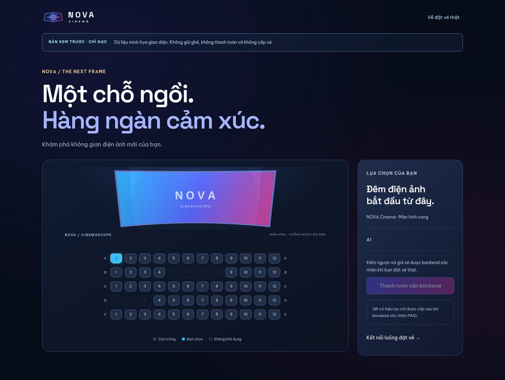
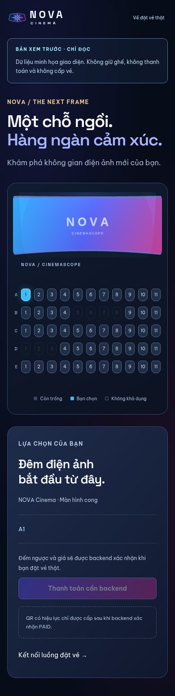
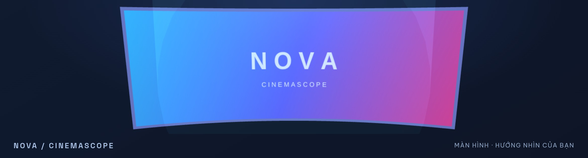

# Creative Cinema — logo, màn hình cong và luồng đặt vé

Ngày kiểm chứng: 27/10/2026. Frontend Next.js 16.4.2 / React, backend NestJS hiện có,
PostgreSQL / Redis / SMTP thật trong môi trường test riêng. Không đổi DTO, schema,
endpoint, giá hay quyền truy cập của backend.

## Mã nguồn bàn giao

| File | Vai trò |
| --- | --- |
| [NovaLogo.jsx](../../src/components/NovaLogo.jsx) | SVG sao Nova trong khung anamorphic, tâm thấu kính, gradient cyan–indigo–magenta và glow; `className`, `showText`, `size`; ID SVG riêng cho từng instance. |
| [CinematicScreen3D.jsx](../../src/components/CinematicScreen3D.jsx) | Tải Three.js / GSAP khi màn hình gần viewport; fallback tĩnh khi thiếu WebGL, tiết kiệm dữ liệu hoặc giảm chuyển động. |
| [cinemaScreen.js](../../src/three/cinemaScreen.js) | Mesh cong thật, CanvasTexture, PointLight và timeline ánh sáng; quản lý toàn bộ tài nguyên WebGL. |
| [SoatVeNhanVien.jsx](../../src/components/SoatVeNhanVien.jsx) | `useMemo` khử ID suất trùng trước khi tạo option; UUID gửi API và giờ `vi-VN`, `Asia/Ho_Chi_Minh` được giữ nguyên. |
| [BookingConsole.jsx](../../src/components/BookingConsole.jsx) | Toàn bộ chọn ghế, combo, giữ ghế, đếm ngược, thanh toán và kết quả vé thật. |
| [DatVeBackend.jsx](../../src/components/DatVeBackend.jsx) | Re-export tương thích với các entrypoint cũ. |
| [BookingTicket.jsx](../../src/components/BookingTicket.jsx) | Đọc vé của chủ đơn sau PAID, chờ worker phát hành và hiển thị QR qua `QRCodeSVG` trong `ETicketQr`. |
| [BookingPreview.jsx](../../src/components/BookingPreview.jsx) | `/xem-truoc`: sơ đồ minh họa độc lập có nhãn chỉ đọc; không gọi API và không tạo giao dịch. |

Logo được dùng ở header, footer và các vị trí thương hiệu; favicon đồng bộ. Hover
xoay nhẹ tia sáng, tăng halo; tắt chuyển động khi người dùng yêu cầu giảm chuyển động.
Typography ưu tiên chữ sáng, tiêu đề lớn và nhãn có độ tương phản rõ.

## Vận hành, hiệu năng và an toàn dữ liệu

- Renderer giới hạn DPR ở 2, render tối đa 30 fps, dừng khi ra ngoài viewport hoặc
  tab bị ẩn. Đây là giới hạn thực thi, không phải cam kết tốc độ trên mọi GPU.
- Cleanup hủy RAF, observer và listener, kill timeline, revert `gsap.context`,
  dispose geometry/material/texture/renderer rồi giải phóng WebGL context.
  Bật/tắt reduced motion và unmount đều đi qua cleanup. Thiếu WebGL vẫn chọn ghế được.
- Lớp canvas trang trí không bắt chuột, khắc phục việc chặn nút khi thông báo mất mạng.
- `uniqueRecords` dùng Map, bỏ bản ghi thiếu ID và giữ bản mới nhất theo ID; áp dụng
  tại catalog, API list, lịch soát vé, snapshot ghế và ví vé. Key UUID–index dùng
  ở các danh sách quan trọng, giá trị option và payload vẫn là UUID gốc.
- Grid cổng thanh toán hai cột ở màn nhỏ, bốn cột khi đủ chỗ; không cố định chiều rộng,
  không bẻ đôi tên cổng. Nút hành động nằm trong `w-full max-w-full box-border`.
- API client giữ cơ chế cookie, refresh và response hiện có; lỗi mạng/timeout/5xx
  phát toast có thể đóng. Toast dùng Motion với `useReducedMotion`, có dọn timer/listener.
- QR chỉ lấy từ vé backend của đúng đơn. Kiểm tra định danh trước khi render;
  trong lúc worker chưa phát hành thì hiện trạng thái chờ. Không tạo QR từ mã đơn
  giả và không dùng LocalStorage để tự gán PAID.

## Quyết định nghiệp vụ để giữ nguyên API

Giữ ghế bắt đầu khi backend xác nhận yêu cầu giữ ghế, với `expiredAt - createdAt`
bằng 300.000 ms. Frontend đếm theo thời hạn server, vô hiệu hóa thanh toán ở 00:00,
đọc lại đơn và snapshot. Backend chuyển đơn hết hạn thành EXPIRED và trả ghế;
hủy chủ động giữ trạng thái CANCELLED theo mô hình hiện có. Quy tắc ghế đã bán,
đang giữ, ghế lẻ và xung đột nhiều khách tiếp tục được server kiểm tra.

Giá ghế, combo, voucher và ưu đãi hạng C’MEMBER dùng giá backend. Chưa có endpoint
đổi điểm thành tiền nên không tự trừ điểm hoặc tự thêm Party Combo 69K vào payload.
Nếu muốn chính sách giá/đổi điểm mới, cần thiết kế nghiệp vụ backend tương ứng.
Nút mô phỏng chỉ dùng luồng Sandbox hiện có; trạng thái PAID và vé do server quyết định.

Fallback minh họa được tách tại `/xem-truoc`, có nhãn rõ và nút thanh toán bị khóa.
Trang đặt vé thật vẫn báo lỗi khi không có server, tránh hiển thị suất/ghế có thể
đặt nhưng không tồn tại trong PostgreSQL.

## Nguồn tham khảo đã đọc và áp dụng

- [greensock/gsap-skills](https://github.com/greensock/gsap-skills/tree/aed9cfd):
  [gsap-react](https://github.com/greensock/gsap-skills/blob/aed9cfd/skills/gsap-react/SKILL.md),
  [gsap-performance](https://github.com/greensock/gsap-skills/blob/aed9cfd/skills/gsap-performance/SKILL.md),
  [gsap-timeline](https://github.com/greensock/gsap-skills/blob/aed9cfd/skills/gsap-timeline/SKILL.md).
  Áp dụng lifecycle React, context/revert, cleanup và timeline phạm vi component.
- [motiondivision/motion](https://github.com/motiondivision/motion/tree/8786166):
  tham khảo AnimatePresence và reduced motion; dùng `framer-motion` đã có trong dự án.
- [mrdoob/three.js](https://github.com/mrdoob/three.js/tree/f17eb5d):
  tham khảo geometry, WebGLRenderer và lights; dùng `three` hiện có.

Dependency bổ sung duy nhất: `gsap` khóa ở 3.15.0. Không thêm skill toàn cục,
không đổi phiên bản Next.js, không thay backend bằng mock hoặc thư viện mới.

## Kiểm chứng

| Nhóm | Kết quả |
| --- | ---: |
| Backend unit | 86 đạt |
| Backend HTTP/nghiệp vụ | 213 đạt |
| PostgreSQL integration | 22 đạt |
| Planner lịch chiếu | 4 đạt |
| QR contract + khử trùng lặp Node | 15 đạt |
| Playwright toàn bộ | 59 đạt |
| **Tổng các ca độc lập** | **399 đạt** |

Frontend lint và production build đạt; backend check gồm lint/typecheck/build đạt.
Kiểm tra BFF khi upstream tắt trả 503, không tạo dữ liệu RAM hoặc báo thành công giả.
Các suite dùng cùng test database/outbox chạy tuần tự; không cộng các lần chạy lại
vào tổng trên.

6 ca Playwright mới kiểm tra preview không gọi API, viewport 320/390/1440,
reduced motion, WebGL thật bằng Chromium SwiftShader (DPR 3 bị giới hạn còn 2),
pause/resume khi cuộn, giải phóng context qua ba lần đổi tùy chọn chuyển động
và khi điều hướng unmount, ID SVG riêng, toast khi lỗi mạng, danh sách trùng ID
và EXPIRED thật qua PostgreSQL/API. Không thay response PAID để vượt kiểm thử.

Các ca có sẵn tiếp tục kiểm tra thanh toán Sandbox, QR thật, quyền quản trị,
soát vé, 24 phim, nhiều phòng và đặt trước 15–30 ngày. Đây là bằng chứng trên môi
trường đã chạy; vẫn cần thử trên GPU/trình duyệt người dùng và cấu hình production.

Lệnh tái kiểm tra (test DB / Redis / SMTP riêng phải sẵn sàng):

```bash
npm run lint
npm run build
npm --prefix backend run check
npm --prefix backend run test:db
node --test backend/scripts/advance-programme.test.cjs
node --test scripts/ticket-qr.test.mjs scripts/unique-records.test.mjs
node scripts/check-backend-only.cjs
npm test
```

Chạy ứng dụng: `npm run dev:full`, mở `http://localhost:3000`.
Trang xem trước: `http://localhost:3000/xem-truoc`.
Sau khởi động, health backend, catalogue qua BFF và trang preview đều trả HTTP 200;
catalogue dev tại thời điểm kiểm tra có 24 phim, 2 rạp, 80 phòng và 7.482 suất thật.

## Ảnh giao diện minh họa

Ảnh chỉ dùng sơ đồ minh họa công khai, không chứa vé/QR/tài khoản thật.






