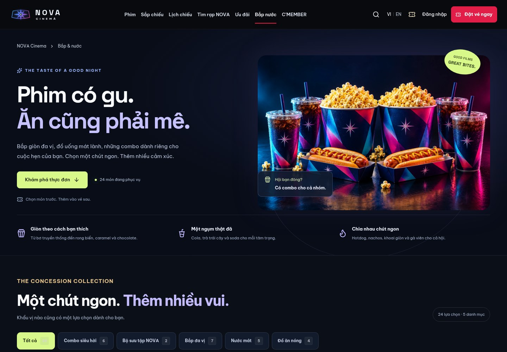
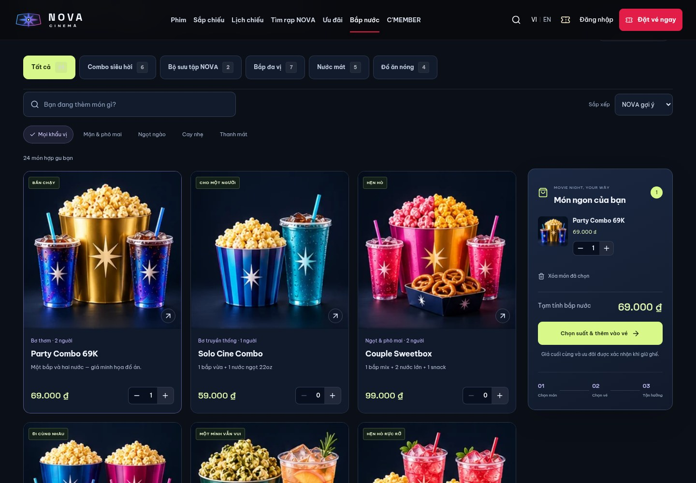
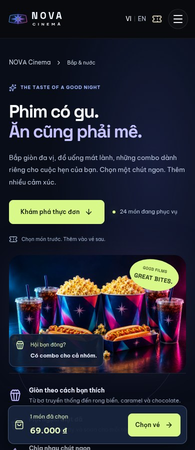
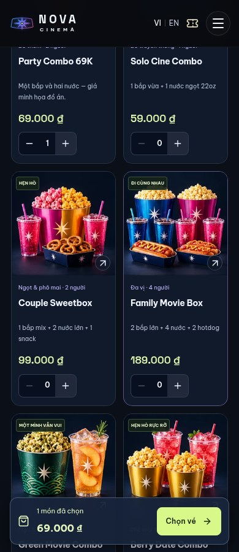
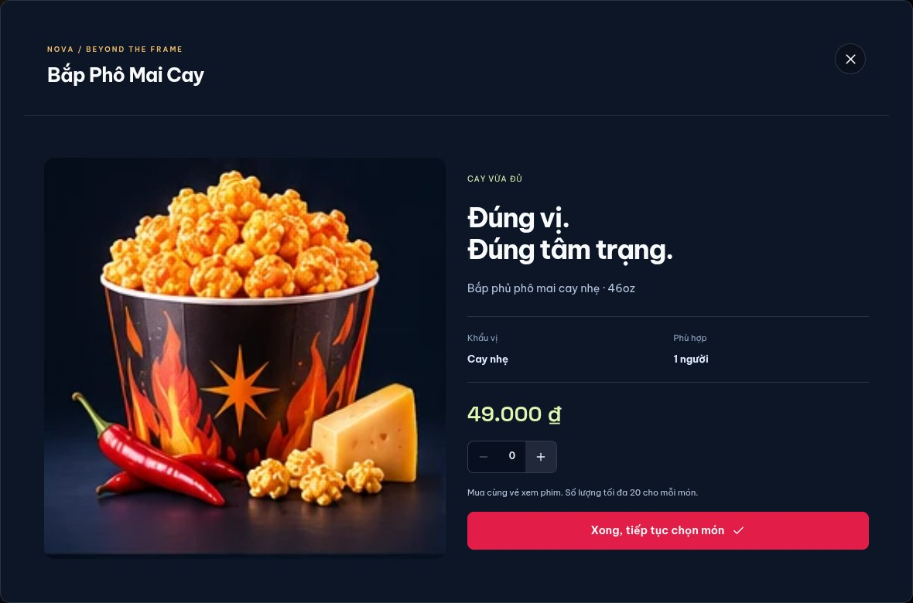

# NOVA Food Studio

Ngày cập nhật: 27/10/2026. Trang `/bap-nuoc` được thiết kế lại trước khi chạy
kiểm thử hồi quy toàn bộ. Các thay đổi cũng áp dụng cho bắp nước ở trang chủ,
ảnh combo trong ưu đãi và bước chọn ghế.

## Đánh giá và thay đổi

| Phần trước đây còn thiếu | Bản nâng cấp |
| --- | --- |
| Banner bắp nước dùng ảnh sảnh và minh họa nhỏ | Ảnh campaign riêng có độ phân giải cao, chữ lớn, màu tím/cyan và nút khám phá thực đơn màu xanh sáng. |
| 16 món với minh họa tương tự nhau | 24 món, mỗi món có packshot riêng: bơ, phô mai, caramel, mix, cay, rong biển, chocolate, trà, soda và đồ ăn nóng. |
| Chỉ lọc danh mục | Tìm tiếng Việt có/không dấu, lọc khẩu vị kết hợp danh mục và sắp xếp giá số tăng/giảm. |
| Không có thông tin khi bấm ảnh | Hộp chi tiết có mô tả, khẩu vị, khẩu phần tham khảo, giá và số lượng; Escape đóng và trả focus. |
| Giỏ món ít thông tin | Giỏ bên cạnh trên desktop, ảnh từng món, sửa số lượng, tổng tạm tính, xóa giỏ và chuyển sang chọn vé. Mobile có thanh tổng tiền và liên kết tới giỏ. |
| Ảnh combo chưa nhất quán giữa các trang | Dùng chung `MenuImage` trên thực đơn, trang chủ, ưu đãi và console đặt vé. |
| Dữ liệu giỏ hỏng có thể làm lỗi chọn combo | Chuẩn hóa dữ liệu; bỏ null, mảng, chuỗi số, NaN và Infinity; số nguyên 0–20; không crash khi storage bị chặn. |

Không thêm món chỉ tồn tại trên frontend. Trong chế độ NestJS, danh sách, UUID, trạng thái bán và giá
được đọc từ `/showtimes/programme`; frontend chỉ bổ sung mô tả thị giác/khẩu vị
cho các món NOVA đã biết. `imageUrl` do quản trị cấu hình được ưu tiên; ảnh lỗi
quay về SVG cục bộ. Nếu API chương trình mất kết nối, frontend không tự sinh món để thanh toán.

## Danh mục và ảnh

Thêm 8 món: Bắp Phô Mai Cay, Bắp Rong Biển, Bắp Chocolate, Soda Dâu Lấp Lánh,
Trà Chanh Tươi, Gà Viên Giòn, Green Movie Combo và Berry Date Combo.
`seed-discovery.cjs` chỉ bổ sung ID còn thiếu, không sửa giá/nội dung mà quản trị
đã thay đổi, không đổi schema hoặc hợp đồng request/response. Chạy tại `backend/`:

```bash
npm run db:seed:discovery
```

Đã chạy lại seed và đối chiếu 24 hàng combo trong database dev: ID, tên, mô tả,
giá, ảnh và cờ hoạt động đều giữ nguyên, không tạo thêm bản trùng.

24 packshot nguyên bản nằm trong một WebP 4 cột × 6 hàng, khoảng 322 KiB;
component hiển thị đúng ô riêng cho từng món, dùng chung cache. Ảnh hero riêng
khoảng 300 KiB để không phóng lớn ảnh thumbnail. Khung ảnh có tỷ lệ cố định,
thumbnail tải lazy, hero ưu tiên tải; hỗ trợ reduced motion. Nguồn và tính chất
minh họa được ghi trong [SOURCES.md](../../public/images/SOURCES.md).

Giỏ trình duyệt chỉ lưu `{comboId: quantity}`. Khi chuyển sang chọn ghế, đơn giữ
chỗ vẫn gửi `comboItems: [{comboId, quantity}]` như trước. Backend xác nhận giá,
ưu đãi và tổng tiền, rồi tiếp tục Sandbox → PAID → QR thật. Không lưu đơn PAID
hoặc tự tính quyền sở hữu vé trong trình duyệt.

Đã ghép commit `b3cf11a` vừa xuất hiện trên GitHub. Theo lựa chọn rõ ràng của bạn,
giữ nguyên launcher tự chuyển sang server RAM khi cổng local 55432 không mở hoặc
seed lỗi. Không thêm lệnh demo riêng. RAM chỉ tồn tại trong vòng đời tiến trình;
health của máy chủ này không phải bằng chứng kết nối PostgreSQL/Redis. Không dùng
RAM làm chứng cứ cho kiểm thử lưu đơn, thanh toán và QR thật trong báo cáo này.
Đồng bộ danh mục RAM từ ba combo cố định sang 24 món trong cùng file content;
giữ các trường response hiện có, dùng UUID ổn định tương ứng với seed PostgreSQL.

## Mã nguồn

- [FoodStore.jsx](../../src/components/FoodStore.jsx): hero, bộ lọc, thực đơn,
  giỏ món và hộp chi tiết; danh mục dùng tab hỗ trợ phím mũi tên/Home/End.
- [MenuImage.jsx](../../src/components/MenuImage.jsx): packshot riêng, ảnh quản
  trị và fallback khi ảnh hỏng.
- [foodCart.js](../../src/foodCart.js): đọc/ghi draft an toàn và tìm kiếm không dấu.
- [food-studio.css](../../src/food-studio.css): bố cục desktop/mobile và chữ rõ.
- [cinema.json](../../content/cinema.json): metadata 24 món, dùng bởi seed bổ sung.

## Kiểm chứng

Các ca Playwright mới dùng PostgreSQL, Redis, SMTP và NestJS thật trong test DB
riêng; không giả response thanh toán. Fixture tái sử dụng món đã có hoặc tạo
đúng các hàng có đánh dấu sở hữu; teardown chỉ xóa dữ liệu do suite tạo.

Các tình huống mới gồm: 24 packshot khác nhau và ID khớp API; tìm `TRA DAO`
trả cả trà đào lẫn combo có trà đào; lọc/sắp xếp; cap số lượng 20; draft null và
storage bị chặn; viewport 320/390/768; chi tiết món và trả focus; ảnh admin hỏng;
backend mất kết nối. Luồng thực tế mua Green Movie Combo + Berry Date Combo
xác nhận tổng combo **208.000đ** trong response giữ ghế, sau đó thanh toán
Sandbox và hiển thị QR vé backend.

Lệnh kiểm tra:

```bash
npm run lint
npm run build
node --test scripts/food-cart.test.mjs scripts/ticket-qr.test.mjs scripts/unique-records.test.mjs
npm test
npm --prefix backend run check
npm --prefix backend run test:db
node --test backend/scripts/advance-programme.test.cjs
node scripts/check-fullstack-startup.cjs
node scripts/check-backend-only.cjs
```

| Nhóm kiểm tra | Kết quả |
| --- | ---: |
| Backend unit | 86 đạt |
| Backend HTTP/nghiệp vụ | 213 đạt |
| PostgreSQL integration | 22 đạt |
| Planner lịch chiếu | 4 đạt |
| QR contract, khử trùng lặp và food cart | 20 đạt |
| Trình duyệt | 66 ca độc lập đạt |
| **Tổng** | **411 ca độc lập đạt** |

Lượt Playwright toàn bộ đạt 65/66; một ca lịch giả định hôm nay luôn còn suất
bị sai kỳ vọng khi chạy sau suất cuối ngày theo giờ Việt Nam. Đã sửa ca đó để
đối chiếu ngày còn mở bán với API thật, kiểm tra cả ngày bị khóa và ngày được
chọn, rồi chạy lại riêng đạt. Không bật lại ngày/suất đã qua giờ trên giao diện.
Không cộng các lần chạy lặp vào tổng 411. Toàn bộ 7 ca mới Food Studio đạt trong
lượt hồi quy đầy đủ.

Lint/build frontend và backend check đạt. Smoke test khởi động sao chép ứng dụng
vào workspace tạm, chủ động làm bước seed lỗi, rồi xác nhận launcher chọn đúng
server RAM gốc, Next.js BFF đọc đủ 24 món và giỏ món hoạt động. Không chạm database
thật hoặc thực hiện thanh toán trong ca fallback này. BFF khi upstream tắt trả
503 và không tự báo thành công giả trong trình duyệt.
Sau đó đã chạy lại `npm run dev:full` bằng NestJS/PostgreSQL thật, health/API
và trang bắp nước trả HTTP 200; catalogue có 24 món.

Ảnh dưới đây dùng catalogue dev công khai, không chứa tài khoản hoặc vé/QR của khách.










